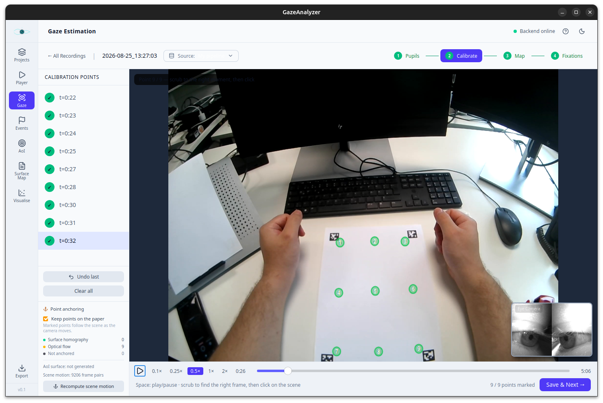
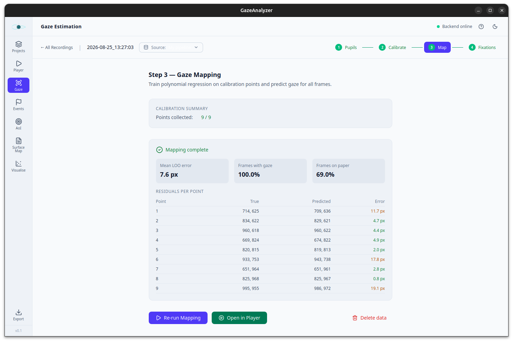
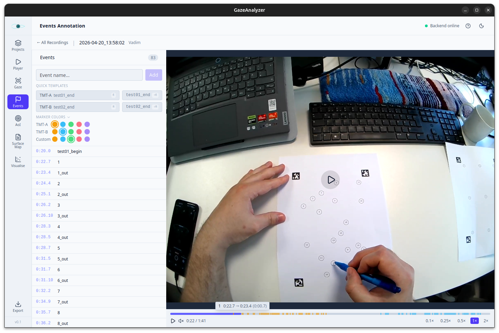
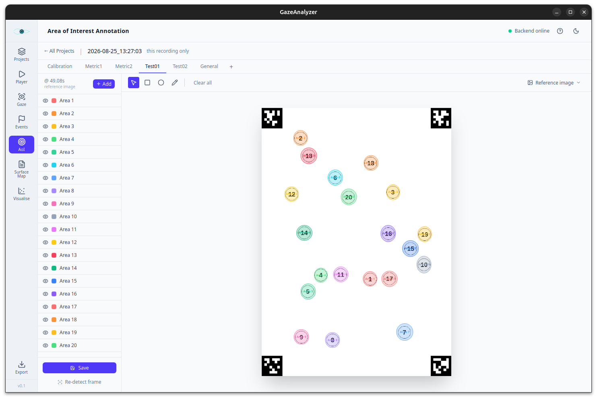
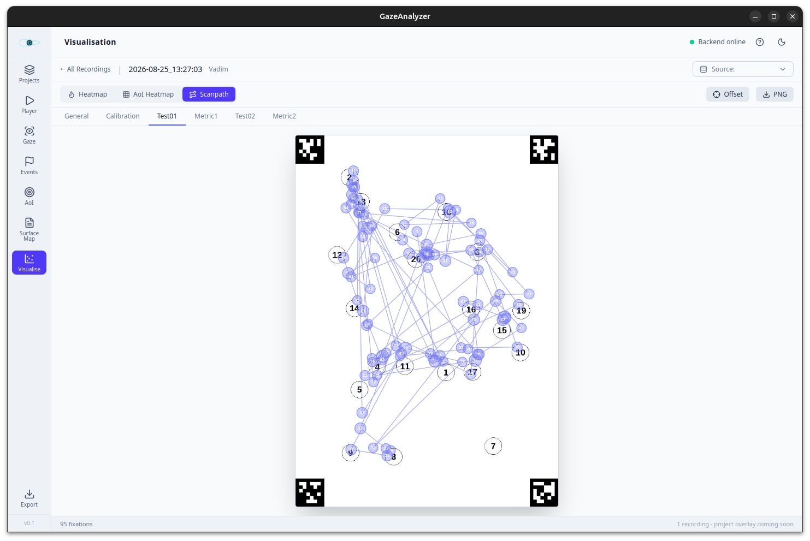

<div align="center">


# 👁️ Gaze Analyser

**An offline desktop application for Pupil Labs Neon recordings: pupil detection, gaze calibration, mapping onto paper stimuli, AoI analysis and Pupil-Labs-compatible export, all in one place**

[](https://tauri.app)
[](https://react.dev)
[](https://www.typescriptlang.org)
[](https://python.org)
[](https://fastapi.tiangolo.com)
[](https://pytorch.org)
[](https://opencv.org)
<br>
[](https://pupil-labs.com/products/neon)
[](INSTALL.md)

<br>

[Video_example.webm](https://github.com/user-attachments/assets/e0211ed8-8074-4251-9523-3b131efbb563)

<sub><i>Surface map: the scene video with the localised sheet and gaze (left), the same moment on the rectified sheet with its AoIs (right).</i></sub>

<br><br>

[**📦 Installation**](INSTALL.md) · [**✨ Features**](#-features) · [**🖼️ Screenshots**](#screenshots) · [**🔄 Workflow**](#-workflow) · [**🛠️ Development**](INSTALL.md#building-from-source)

</div>

---

## 📌 Overview

Pupil Labs Neon glasses record the eye cameras and the scene camera, but the
analysis of paper-based tasks usually requires Pupil Cloud and several manual
tools. **Gaze Analyser** does the whole chain **locally**, on a native Neon
recording:

1. **Pupil detection.** A HeatmapNet (PyTorch) proposes the pupil region. A
   classical pipeline (floodfill with an edge-based fallback, then ellipse
   fitting) delivers a precise pupil centre in both eye cameras.
2. **Calibration and gaze mapping.** Binocular pupil features are mapped to
   scene-camera coordinates with a polynomial **Ridge regression**. Its degree and
   regularisation are chosen by leave-one-out cross-validation on the calibration
   fixations.
3. **Surface mapping.** AprilTags on the sheet localise it in every scene frame,
   and gaze is projected onto the flat paper via a homography.
4. **Analysis.** Fixations, blinks, Areas of Interest, heatmaps and scanpaths,
   segmented by annotated events.

> 🎓 Developed as part of a Master's thesis at the **University of Bonn**. It is
> used for paper-based neuropsychological tests such as the **Trail Making Test
> (TMT-A / TMT-B)**, but works with any flat stimulus that carries AprilTags.

---

## ✨ Features

- 📁 **Projects & import.** Group recordings into projects and import native Neon `.zip` exports directly. Binary sensor streams are converted to CSV on import.
- 🎯 **Own pupil detector.** NN-based ROI plus classical ellipse fitting, with confidence per frame. Runs on CUDA when available.
- 🧭 **Calibration wizard.** *Detect → Calibrate → Map → Fixations → Validate*, each step with a visual check of its quality.
- 😑 **Blink detection.** Derived from the pupil confidence signal and quality-flagged.
- 📐 **Gaze offset correction.** Removes a systematic shift (e.g. parallax) and propagates it to all downstream data.
- ☁️ **Pupil Cloud as an alternative source.** Compare your own gaze against the Cloud gaze on the same recording.
- 🏷️ **Event annotation.** Mark TMT-A / TMT-B start and end or custom events on the timeline, with keyboard shortcuts.
- 🟦 **Areas of Interest.** Rectify the sheet via AprilTags (portrait or landscape) and draw rectangular or free-form AoIs per segment.
- 🗺️ **Surface map.** Scene video and the flattened sheet side by side, with gaze, page outline and detected markers.
- 🔥 **Visualisation.** Gaze heatmap, AoI heatmap (dwell time / fixation count) and scanpath on the paper.
- 📤 **Pupil-compatible export.** Per recording or merged per project.
- 🧑‍🏫 **Built-in guidance.** Interactive guided tour and a help panel on every page.

---

<a name="screenshots"></a>

## 🖼️ Screenshots

<table>
  <tr>
    <td width="50%" align="center">
      
      <br><sub><b>🎯 Calibrate.</b> Mark the nine calibration targets on the scene video. Points stay anchored to the paper while the head moves.</sub>
    </td>
    <td width="50%" align="center">
      
      <br><sub><b>🧭 Map gaze.</b> Polynomial Ridge fit with leave-one-out error, per-point residuals and the share of frames on the paper.</sub>
    </td>
  </tr>
  <tr>
    <td width="50%" align="center">
      
      <br><sub><b>🏷️ Events.</b> Annotate TMT-A / TMT-B with quick templates and keyboard shortcuts. Events appear as coloured marks on the timeline.</sub>
    </td>
    <td width="50%" align="center">
      
      <br><sub><b>🟦 Areas of Interest.</b> The sheet is rectified via its four AprilTags. AoIs are drawn per segment (Calibration, Test01, Test02, …).</sub>
    </td>
  </tr>
  <tr>
    <td colspan="2" align="center">
      
      <br><sub><b>🔥 Visualisation.</b> Scanpath of the TMT-A segment on the paper. Heatmap and AoI heatmap are one click away.</sub>
    </td>
  </tr>
</table>

---

## 🔄 Workflow

```text
  Import recording
        │
        ▼
  Detect pupils ──► Calibrate ──► Map gaze ──► Fixations ──► Validate
                                     ▲
  Events (segments) ──► AoI (draw) ──┘
                                     │
                                     ▼
              Surface map  ·  Visualisation  ·  Export
```

> ⚠️ **Draw the AoI surface _before_ mapping gaze.** Gaze is projected onto the
> paper using the surface defined in the AoI page. If you map first, the paper
> coordinates stay empty until you re-run **Map Gaze**.

---

## 📤 Exported data

| File | Content |
|---|---|
| `pupils.csv` | Pupil centre, ellipse and confidence per eye frame |
| `blinks.csv` | Detected blinks with start, end and quality flag |
| `gaze_predictions.csv` | Gaze in scene-camera pixels per frame |
| `fixations.csv` | I-DT fixations in scene coordinates |
| `fixations_on_surface.csv` | Fixations in normalised paper coordinates |
| `surface_positions.csv` | Sheet homography and detected markers per scene frame |
| `aoi_fixations.csv` | Fixation-to-AoI assignment |
| `aoi_metrics.csv` | Fixation count, total and average fixation duration, and time to first fixation per AoI |
| `events.csv` | Annotated events |

The column layout follows Pupil Player / Pupil Cloud exports, so existing analysis
scripts can be reused.

---

## 🏗️ Architecture

| Layer | Stack |
|---|---|
| 🖥️ Desktop shell | **Tauri 2** (Rust) |
| 🎨 Frontend | **React 19** + TypeScript + Tailwind CSS (Vite) |
| ⚙️ Backend | **Python 3.12**, FastAPI + Uvicorn, SQLite |
| 🧠 Processing | PyTorch, OpenCV, `pupil-apriltags`, scikit-learn, SciPy |

In the installed app the Python backend is frozen with PyInstaller and shipped
inside the bundle. The Rust shell starts it on a free local port and stops it
when the window closes. **No data ever leaves the machine.**

```text
PupilLabsReplacer/
├── src/                  # React frontend: pages, components, API client
├── src-tauri/            # Tauri / Rust shell
├── backend/
│   ├── app/              # FastAPI: routes, services, DB, vendored gaze pipeline
│   ├── run.py            # Entry point of the packaged backend
│   └── gazeanalyzer-backend.spec   # PyInstaller build
└── installers/windows/   # Inno Setup script for the Windows installer
```

---

## 📦 Installation

Ready-made installers for **Windows** (`setup.exe`) and **Linux** (`.deb` /
`.rpm`) are on the [Releases page](https://github.com/vdmchaykin/GazeAnalyser/releases).

👉 Step-by-step instructions, system requirements, troubleshooting and building
from source: **[INSTALL.md](INSTALL.md)**

> 💡 An **NVIDIA GPU** is strongly recommended. Without one, pupil detection falls
> back to the CPU and takes hours per recording instead of minutes.

### 💾 Where the data lives

| OS | Path |
|---|---|
| 🪟 Windows | `%APPDATA%\GazeAnalyzer` |
| 🐧 Linux | `~/.local/share/GazeAnalyzer` |
| 🍎 macOS | `~/Library/Application Support/GazeAnalyzer` |

Override it with the `GAZEANALYZER_DATA_DIR` environment variable.

---

<div align="center">
<sub>Made at the University of Bonn · Built with Tauri, React and PyTorch</sub>
</div>
